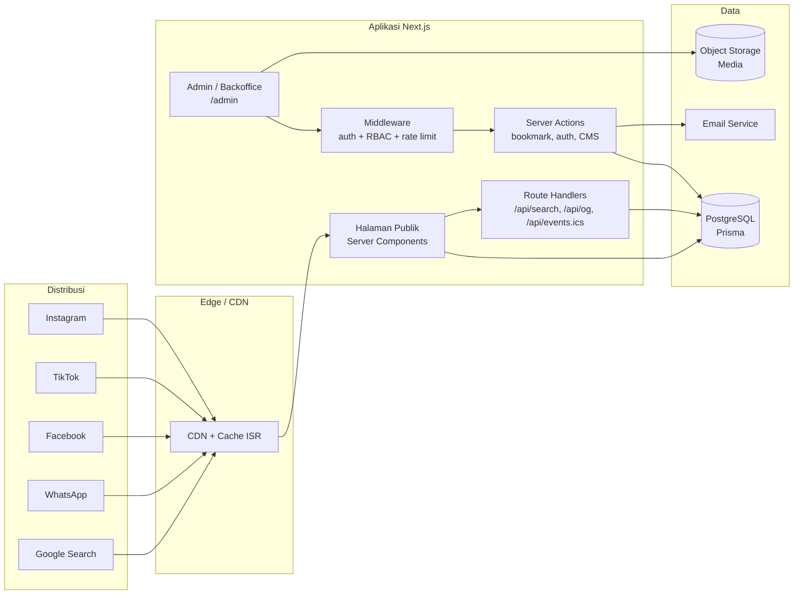
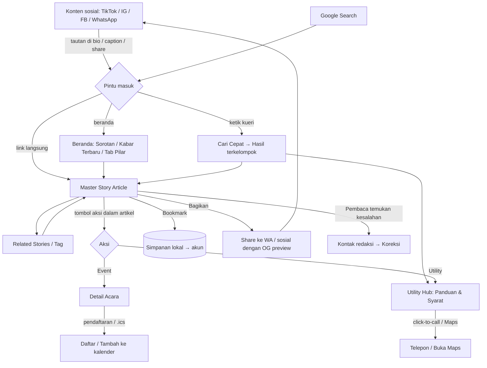
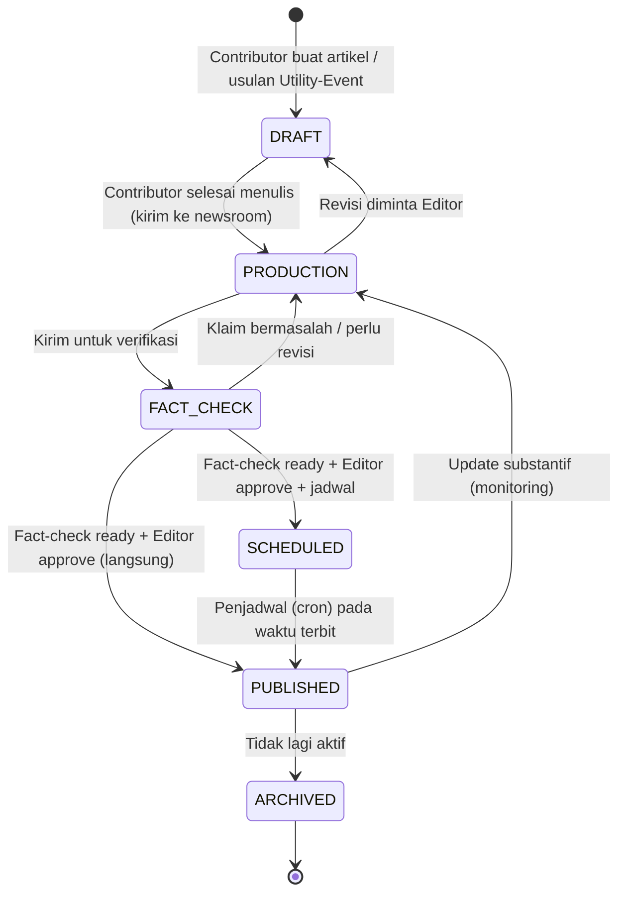
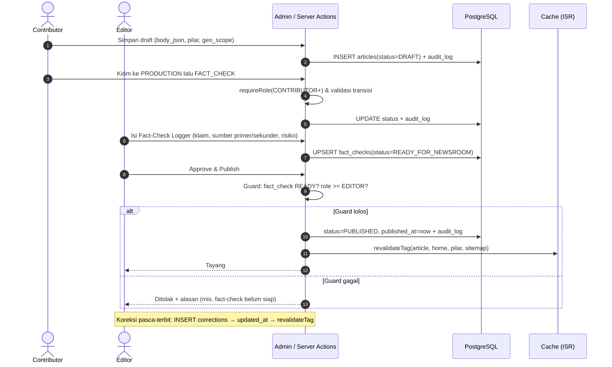
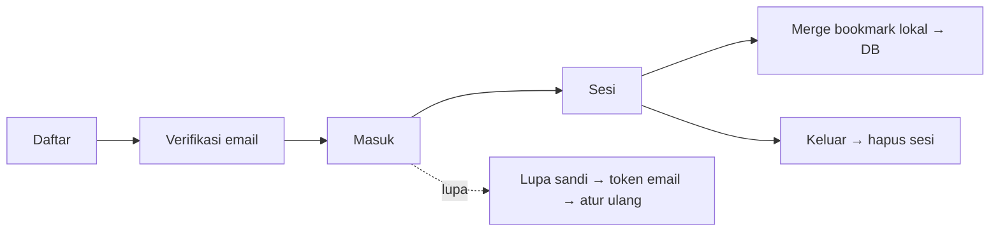

# ARCHITECTURE — Palihmana.id

> **Technical Architecture & Flow** · Versi 1.0 · Oktober 2026
> Prinsip: *arsitektur yang bisa tumbuh tanpa over-engineering.* Satu aplikasi (monolit modular), satu database, caching agresif untuk halaman publik.
> Dokumen terkait: `PRD.md`, `DESIGN.md`, `DATABASE.md`.

---

## 1. Tech Stack Definition

| Lapisan | Pilihan | Alasan |
|---------|---------|--------|
| Framework | **Next.js (App Router)**, TypeScript | SSR/ISR untuk SEO, satu codebase frontend + backend |
| UI | **Tailwind CSS** + komponen sendiri (opsional Radix UI untuk primitif aksesibel) | Token desain konsisten (lihat DESIGN.md), bundel kecil |
| Backend | **Next.js Server Actions & Route Handlers** (runtime Node.js) | Tanpa layanan terpisah; cukup untuk skala awal |
| Database | **PostgreSQL** via **Supabase** atau **Neon** | Relasional, full-text search, pg_trgm; managed backup |
| ORM | **Prisma** | Skema terdokumentasi, migrasi terkendali, tipe aman |
| Auth | **Auth.js (NextAuth)** *atau* **Supabase Auth** | Lihat §1.2 |
| Editor konten | **TipTap** (JSON dokumen → `body_json`) | Output terstruktur, mudah dirender & diindeks |
| Penyimpanan media | Supabase Storage / Cloudflare R2 (S3-compatible) | Murah, CDN |
| Email transaksional | Resend / Brevo / SMTP (Fase 4) | Verifikasi & reset kata sandi |
| Hosting | **Vercel** (app) + Supabase/Neon (DB) — *keputusan final menunggu OQ-2* | Deploy cepat; alternatif VPS + Docker |
| Observabilitas | Vercel Analytics / Plausible/GA4, Search Console, Sentry, uptime monitor | KPI & deteksi galat |
| CI/CD | GitHub Actions: lint, typecheck, test, Prisma migrate check, Lighthouse CI | Cegah regresi performa |

### 1.1 Keputusan Arsitektur Utama (ADR ringkas)

| # | Keputusan | Alasan | Konsekuensi |
|---|-----------|--------|-------------|
| ADR-1 | Monolit modular Next.js, bukan microservice | Tim kecil, mudah dirawat | Batas modul dijaga lewat folder `modules/` |
| ADR-2 | Halaman publik dirender server + di-cache (ISR/tag revalidation) | Cepat di mobile, SEO | Perlu `revalidateTag` saat publish/koreksi |
| ADR-3 | Pencarian memakai PostgreSQL FTS + trigram, bukan layanan eksternal | Data kecil, biaya nol tambahan | Evaluasi ulang bila >50 rb dokumen |
| ADR-4 | Bookmark Fase 3 bersifat lokal; sinkron ke DB setelah Fase 4 | Retensi tanpa friksi login | Perlu logika merge saat login |
| ADR-5 | `body_json` (TipTap) sebagai sumber isi artikel | Struktur kaya (summary, tabel, FAQ) & aman dari XSS | Perlu renderer sendiri |
| ADR-6 | Pembagian tanggung jawab data: `articles` ≠ `utilities` ≠ `events` | Setiap tipe punya siklus pembaruan berbeda | Search menggabungkan hasil lintas tabel |
| ADR-7 | RBAC ditegakkan di server (middleware + guard per aksi) | UI bukan batas keamanan | Setiap Server Action wajib memanggil `requireRole()` |

### 1.2 Pilihan Autentikasi

| Kriteria | Auth.js (NextAuth) + Prisma Adapter | Supabase Auth |
|----------|--------------------------------------|---------------|
| Kontrol skema `users` sendiri | ✅ Penuh | ⚠️ Terpisah di skema `auth`, perlu sinkron |
| Verifikasi email / reset sandi | Perlu dibuat (token + email) | Bawaan |
| Kesederhanaan | Sedang | Tinggi bila sudah memakai Supabase |
| Ketergantungan vendor | Rendah | Lebih tinggi |

**Rekomendasi:** gunakan **Auth.js dengan Credentials + (opsional) Google**, sesi JWT/database, tabel `users` milik aplikasi (selaras `DATABASE.md`). Jika tim memilih ekosistem Supabase penuh, gunakan Supabase Auth dan simpan profil/role di tabel `users` yang kuncinya merujuk `auth.users.id`. Keputusan final ditetapkan sebelum Fase 4; Fase 1–3 tidak bergantung padanya kecuali akun staf (lihat §4.3).

---

## 2. Arsitektur Sistem

### 2.1 Gambaran Tingkat Tinggi



### 2.2 Struktur Proyek (usulan)

```
palihmana/
├─ prisma/
│  ├─ schema.prisma
│  ├─ migrations/
│  └─ seed.ts
├─ src/
│  ├─ app/
│  │  ├─ (public)/
│  │  │  ├─ page.tsx                      # Beranda
│  │  │  ├─ [pilar]/page.tsx              # Kategori Jelajah (Fase 2)
│  │  │  ├─ [pilar]/[slug]/page.tsx       # Baca Artikel
│  │  │  ├─ [pilar]/[slug]/opengraph-image.tsx
│  │  │  ├─ cari/page.tsx                 # Cari Cepat
│  │  │  ├─ kalender/…                    # Fase 2
│  │  │  ├─ layanan/…                     # Fase 2
│  │  │  ├─ simpanan/page.tsx             # Fase 3
│  │  │  └─ (auth)/masuk | daftar | lupa-sandi   # Fase 4
│  │  ├─ admin/…                          # Editor minimal (F1) → Backoffice (F4)
│  │  ├─ api/
│  │  │  ├─ search/route.ts
│  │  │  ├─ suggest/route.ts
│  │  │  └─ events/[id]/ics/route.ts
│  │  ├─ sitemap.ts · robots.ts · news-sitemap.xml/route.ts
│  │  └─ layout.tsx
│  ├─ modules/
│  │  ├─ articles/   (queries.ts, actions.ts, workflow.ts, render.tsx)
│  │  ├─ factcheck/
│  │  ├─ search/
│  │  ├─ events/
│  │  ├─ utilities/
│  │  ├─ bookmarks/
│  │  ├─ auth/       (session.ts, rbac.ts, permissions.ts)
│  │  └─ audit/
│  ├─ components/ (ui/, article/, utility/, nav/)
│  ├─ lib/ (db.ts, seo/, jsonld/, cache.ts, ratelimit.ts, env.ts)
│  └─ middleware.ts
├─ docs/ (PRD.md, DESIGN.md, ARCHITECTURE.md, DATABASE.md, RUNBOOK.md)
└─ .github/workflows/
```

### 2.3 Strategi Rendering & Cache

| Rute | Strategi | Revalidasi |
|------|----------|------------|
| `/` Beranda | ISR | tag `home`, `articles`; revalidate saat publish/koreksi/ubah sorotan |
| `/[pilar]` | ISR | tag `pilar:{x}` |
| `/[pilar]/[slug]` | ISR (`generateStaticParams` untuk artikel terbaru) | tag `article:{id}`; revalidate saat update/koreksi |
| `/cari` | Dinamis (data dari `/api/search`) | Cache singkat untuk kueri populer (60 dtk) |
| `/layanan`, `/layanan/[slug]` | ISR | tag `utilities` |
| `/kalender`, `/kalender/[id]` | ISR + revalidate harian | tag `events`; `unstable_cache` per rentang tanggal |
| `/simpanan` | Client (data localStorage) / dinamis jika login | Tidak di-cache publik |
| `/admin/**`, `/akun/**` | Dinamis, `no-store`, di balik auth | — |

Aturan: **tidak ada data pribadi pada halaman yang di-cache publik.** Komponen personal (tombol simpan, tema) hidrasi di client.

---

## 3. User & Admin Flow Diagrams

### 3.1 Flow Pembaca: Discovery → Master Story → Utility/Event Action

Mengikuti prinsip *Social-first for distribution, Web-first for knowledge*.



**Catatan alur**
- Metrik utility (klik nomor, peta, pendaftaran, pencarian, kalender) dicatat sebagai event analytics tanpa data pribadi.
- Siklus berulang: artikel dibagikan kembali ke sosial → membawa audiens baru ke web.

### 3.2 Flow Editorial: Contributor Draft → Fact-Check → Editor Approval & Publish





**Aturan transisi (ditegakkan di `modules/articles/workflow.ts`)**

| Dari → Ke | Role minimum | Syarat tambahan |
|-----------|--------------|-----------------|
| DRAFT → PRODUCTION | CONTRIBUTOR (pemilik) | Judul, pilar, ringkasan terisi |
| PRODUCTION → FACT_CHECK | CONTRIBUTOR (pemilik) | Isi minimal tersedia |
| FACT_CHECK → PRODUCTION | EDITOR | Alasan tercatat |
| FACT_CHECK → SCHEDULED/PUBLISHED | EDITOR | `fact_checks.status = READY_FOR_NEWSROOM`; slug unik; gambar punya alt text |
| PUBLISHED → ARCHIVED | EDITOR | — |
| PUBLISHED → PRODUCTION | EDITOR | Alasan update substantif |
| Override aturan | SUPER_ADMIN | Alasan wajib, tercatat di audit log |

### 3.3 Flow Auth (Fase 4)



---

## 4. Keamanan

### 4.1 Prinsip
- *Least privilege*, validasi di server, default menolak.
- Rahasia hanya di variabel lingkungan; validasi `env` saat boot (`zod`).
- Dependensi dikunci (`package-lock`), audit rutin (`npm audit`, Dependabot).

### 4.2 Kontrol
| Area | Kontrol |
|------|---------|
| Kata sandi | argon2id (atau bcrypt cost ≥ 12); tidak pernah disimpan/di-log mentah |
| Sesi | Cookie `HttpOnly`, `Secure`, `SameSite=Lax`; masa berlaku wajar; rotasi pada login |
| CSRF | Server Actions bawaan Next.js + pemeriksaan origin |
| Rate limit | Upstash Ratelimit / tabel kecil: login, reset sandi, pencarian, share |
| Input | Validasi `zod` di setiap Server Action/Route; sanitasi `body_json` saat render (daftar node yang diizinkan) |
| Header | CSP ketat, HSTS, `X-Content-Type-Options`, `Referrer-Policy`, `Permissions-Policy` |
| Upload | Batasi tipe & ukuran; ganti nama file; proses ulang gambar (strip EXIF lokasi) |
| RBAC | `requireRole()` + pemeriksaan kepemilikan sumber daya di setiap aksi tulis |
| Audit | Tabel `audit_logs` untuk login staf, perubahan status, publish, ubah role, hapus, override |
| Backup | Backup otomatis harian + PITR bila tersedia; uji pemulihan berkala (didokumentasikan di RUNBOOK) |
| Privasi | Bookmark anonim hanya di perangkat; analytics tanpa PII; kepatuhan UU PDP |

### 4.3 Akun Staf pada Fase 1–3
Sebelum pendaftaran publik (Fase 4), akun staf dibuat oleh Super Admin (seed/skrip/panel admin), login dengan kredensial + (disarankan) 2FA. Tidak ada rute pendaftaran publik sebelum Fase 4.

---

## 5. SEO & Performance Architecture

### 5.1 Dynamic OpenGraph Generator (preview WhatsApp/Sosial)

- Setiap artikel/acara/layanan memiliki gambar OG dinamis **1200×630** dengan `next/og` (`ImageResponse`), berisi: label pilar, judul, tanggal, logo Palihmana, foto utama bila ada.
- Berkas `opengraph-image.tsx` pada segmen `[pilar]/[slug]`; fallback ke gambar default merek bila data tidak ada.
- Metadata via `generateMetadata`: `title`, `description` (dari `summary_points`/subtitle), `canonical`, `openGraph` (`type: article`, `publishedTime`, `modifiedTime`, `authors`, `section`), `twitter: summary_large_image`.
- WhatsApp membaca OG dari HTML awal: pastikan tag **dirender server** dan gambar < ~300 KB; uji lewat WhatsApp/Facebook Sharing Debugger.
- Cache gambar OG di CDN; invalidasi saat judul/foto berubah.

```tsx
// src/app/(public)/[pilar]/[slug]/opengraph-image.tsx (sketsa)
import { ImageResponse } from "next/og";
import { getArticleMeta } from "@/modules/articles/queries";

export const size = { width: 1200, height: 630 };
export const contentType = "image/png";

export default async function OG({ params }: { params: { pilar: string; slug: string } }) {
  const a = await getArticleMeta(params.slug);
  return new ImageResponse(
    (
      <div style={{ display: "flex", flexDirection: "column", justifyContent: "space-between",
                    width: "100%", height: "100%", padding: 64, background: "#F9F9F7", color: "#1A1A1A" }}>
        <div style={{ fontSize: 28, fontWeight: 700, color: "#0F4C3A" }}>PALIHMANA.ID · {a?.pilarLabel}</div>
        <div style={{ fontSize: 64, lineHeight: 1.15, fontWeight: 700 }}>{a?.title}</div>
        <div style={{ fontSize: 26, color: "#5B6360" }}>{a?.dateLabel}</div>
      </div>
    ),
    size
  );
}
```
(Font OG dimuat lewat `fetch` berkas font lokal; pastikan mendukung karakter Indonesia.)

### 5.2 Schema.org Structured Data (JSON-LD)

| Tipe konten | Schema | Properti kunci |
|-------------|--------|----------------|
| Artikel (semua pilar) | `NewsArticle` (atau `Article` untuk evergreen/Understand) | `headline`, `image`, `datePublished`, `dateModified`, `author`, `publisher`, `mainEntityOfPage`, `articleSection` |
| Artikel dengan koreksi | `NewsArticle` + `correction` (`CorrectionComment`) | teks koreksi & tanggal |
| Acara | `Event` | `name`, `startDate`, `endDate`, `location` (`Place` + alamat), `organizer`, `isAccessibleForFree`, `offers`, `eventStatus`, `url` |
| Layanan/tempat | `LocalBusiness` / `GovernmentOffice` / `MedicalClinic` (sesuai kategori) | `name`, `address`, `telephone`, `openingHoursSpecification`, `geo`, `url` |
| Panduan Q&A | `FAQPage` | `mainEntity` (Question/Answer) |
| Panduan langkah | `HowTo` (opsional; cek kebijakan Google terbaru sebelum dipakai) | `step`, `totalTime` |
| Situs | `Organization`, `WebSite` + `SearchAction`, `BreadcrumbList` | — |

Aturan: JSON-LD dihasilkan dari data database melalui helper `lib/jsonld/`, divalidasi di CI (skrip memeriksa JSON valid) dan secara berkala dengan Rich Results Test. Jangan memuat markup untuk konten yang tidak tampil di halaman.

### 5.3 Teknis SEO Lain
- **Sitemap** dinamis (`sitemap.ts`) + **news sitemap** untuk artikel 48 jam terakhir; `robots.ts`; kirim ke Search Console.
- **Permalink bersih** `/{pilar}/{slug}`; slug tidak berubah setelah terbit; jika harus berubah → 301 via tabel redirect.
- **Canonical** untuk halaman berparameter; `noindex` untuk hasil pencarian internal, `/admin`, `/akun`.
- **Internal linking:** related stories, tag, breadcrumb.
- **Hreflang** tidak diperlukan (hanya `id-ID`); `<html lang="id">`.
- **Freshness:** `dateModified` hanya berubah pada pembaruan substantif atau koreksi, bukan setiap penyimpanan.

### 5.4 Anggaran Performa & Strategi

| Metrik | Target |
|--------|--------|
| Lighthouse mobile (Perf/A11y/BP/SEO) | ≥ 90 |
| LCP | ≤ 2,5 s (hero image `priority`, ukuran responsif) |
| INP | ≤ 200 ms |
| CLS | ≤ 0,1 (rasio gambar tetap, font `next/font`) |
| JS awal beranda/artikel | < 100 KB gz (utamakan Server Components; client component seperlunya) |
| TTFB (cache hit) | < 200 ms |

Strategi: Server Components default; `next/image` (AVIF/WebP); font self-host; lazy-load komponen berat (kalender, editor) dengan `dynamic()`; embed pihak ketiga dengan facade; query dengan indeks yang sesuai; `select` kolom seperlunya; CDN untuk media; Lighthouse CI di PR dengan ambang gagal.

---

## 6. Pencarian (Cari Cepat)

**Pendekatan:** PostgreSQL Full-Text Search + `pg_trgm`, tanpa mesin pencari terpisah.

- Kolom `search_vector` (`tsvector`, konfigurasi `simple` agar tidak bergantung pada kamus bahasa; bobot: judul **A**, subjudul/ringkasan **B**, isi teks **C**) dengan indeks **GIN**. Diisi trigger/ekspresi saat insert/update.
- Indeks **trigram GIN** pada `title` dan `tag.name` untuk toleransi typo dan *auto-suggest* awalan.
- **Endpoint** `GET /api/search?q=…&limit=…` → respons terkelompok:
  ```json
  { "articles": [...], "utilities": [...], "events": [...] }
  ```
  (`events` baru aktif di Fase 2; `utilities` pada Fase 1 berasal dari artikel pilar Utility.)
- **Endpoint** `GET /api/suggest?q=…` → daftar saran dari judul, tag, dan kueri populer (tabel agregasi `search_queries`).
- Hanya artikel `PUBLISHED`, utility `is_active`, event mendatang yang diindeks/ditampilkan.
- Debounce 250 ms di client, `AbortController` untuk membatalkan permintaan lama, rate limit per IP.
- Prisma tidak mendukung FTS lanjutan sepenuhnya → gunakan `$queryRaw` yang diparameterisasi (hindari injeksi).

---

## 7. Lingkungan, Deployment, & Operasional

| Lingkungan | Tujuan | Data |
|------------|--------|------|
| `local` | Pengembangan | DB lokal / Docker + seed |
| `preview` | Setiap PR (Vercel Preview) | DB branch/staging |
| `staging` | Uji tim & editorial | Salinan data sampel |
| `production` | Publik | Data nyata |

**Variabel lingkungan inti:** `DATABASE_URL`, `DIRECT_URL`, `AUTH_SECRET`, `NEXT_PUBLIC_SITE_URL`, `STORAGE_*`, `EMAIL_*`, `SENTRY_DSN`, `REVALIDATE_SECRET`.

**Pipeline CI/CD:** lint → typecheck → unit test (workflow transisi, RBAC, util) → `prisma validate` & `migrate diff` → build → Lighthouse CI → deploy. Migrasi produksi dijalankan dengan `prisma migrate deploy` setelah backup.

**Runbook minimum (didokumentasikan di `docs/RUNBOOK.md`):** domain/DNS/hosting, penyedia DB & backup, rotasi rahasia, prosedur restore, daftar dependensi, siapa yang berhak menyetujui perubahan teknis, cara menambah staf, respons insiden.

**Pemantauan:** uptime (menit), error tracking, Search Console (cakupan, CWV), dashboard KPI (organic traffic, returning users, utility actions, freshness).

---

## 8. Pemetaan Fase → Pekerjaan Teknis

| Fase | Pekerjaan teknis utama |
|------|------------------------|
| **1** | Repo & CI, token desain, layout & komponen dasar, model `articles`/`users`/`corrections`, editor minimal + akun staf, renderer `body_json`, Beranda, Artikel (OG, JSON-LD, tema, share, freshness, koreksi), Cari (FTS/trigram), sitemap/robots, analytics, backup |
| **2** | Halaman pilar & tag, model `events`/`utilities`, Kalender (list + bulan + .ics), Utility Hub (click-to-call, panduan), JSON-LD Event/LocalBusiness/FAQ, perluasan hasil cari terkelompok |
| **3** | Modul bookmark lokal, kategori favorit (lokal), halaman Simpanan, desain indikator "diperbarui" |
| **4** | Auth penuh (daftar, masuk, lupa sandi, verifikasi email), merge bookmark lokal → DB, RBAC lengkap, workflow status + fact-check logger, audit log UI, penjadwal publish (cron), dashboard ringkas |

---

## 9. Risiko Teknis & Mitigasi

| Risiko | Mitigasi |
|--------|----------|
| Cache menampilkan data usang setelah koreksi | `revalidateTag` terpusat dalam satu fungsi `publishSideEffects()` + uji |
| FTS Prisma terbatas | `$queryRaw` terenkapsulasi di `modules/search`, dengan tes |
| Vendor lock-in (Supabase/Vercel) | Standar terbuka (PostgreSQL, S3, Auth.js); runbook migrasi |
| Konten `body_json` berbahaya (XSS) | Renderer whitelist, tidak memakai `dangerouslySetInnerHTML` untuk input pengguna |
| Biaya tumbuh tak terduga | Anggaran & alarm biaya; cache agresif; gambar dioptimalkan |
| Satu orang menjadi titik gagal | Dokumentasi, akses bergilir, 2 admin teknis minimal |
