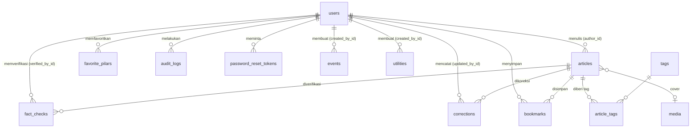

# DATABASE — Palihmana.id

> **Database Schema & Migration Plan** · Versi 1.0 · Oktober 2026
> Mesin: PostgreSQL (Supabase / Neon) · ORM: Prisma (6.x).
> Dokumen terkait: `PRD.md`, `ARCHITECTURE.md`.

---

## 1. Ringkasan Desain

| Prinsip | Penerapan |
|---------|-----------|
| Delapan tabel inti sesuai spesifikasi | `users`, `articles`, `fact_checks`, `corrections`, `utilities`, `events`, `bookmarks`, `audit_logs` |
| Tabel pendukung (tambahan, diberi tanda ➕) | `tags`, `article_tags`, `favorite_pilars`, `password_reset_tokens`, `search_queries`, `redirects`, `media` |
| Penamaan | Model PascalCase di Prisma, tabel/kolom `snake_case` di database via `@@map` / `@map` |
| ID | `cuid()` (string) agar aman dipakai di URL/API |
| Waktu | `timestamptz`, disimpan UTC; ditampilkan WIB (Asia/Jakarta) di aplikasi |
| Hapus data | Artikel tidak dihapus keras; gunakan status `ARCHIVED`. `audit_logs` bersifat *append-only* |
| Isi artikel | `body_json` (dokumen TipTap/ProseMirror) sebagai sumber kebenaran |

### Penyimpangan & Tambahan terhadap Spesifikasi (mohon ditinjau)
| # | Perubahan | Alasan |
|---|-----------|--------|
| 1 | Enum `Role` ditambah **`MEMBER`** (default) | Pembaca terdaftar (Fase 4) memerlukan role tanpa hak backoffice. Empat role yang diminta tetap ada |
| 2 | `users.password_hash` opsional | Mendukung login Google/OAuth tanpa sandi |
| 3 | `articles` ditambah `geo_scope`, `is_featured`, `is_monitoring`, `last_verified_at`, `cover_image`, `reading_minutes`, `is_sponsored` | Kebijakan geografis, sorotan beranda, status MONITORING handbook, freshness badge, kartu artikel, label sponsor |
| 4 | "`updated_at/freshness_badge`" dipecah: `updated_at` (otomatis, teknis) dan `content_updated_at` (pembaruan substantif, dasar freshness badge) | Menyimpan typo-fix tidak boleh mengubah "Diperbarui" yang tampil ke publik |
| 5 | `fact_checks` ditambah `unverified_items`, `comparability`, `status`, `checked_at` | Standar Riset & Verifikasi handbook (butir belum terverifikasi, comparability check, status kesiapan) |
| 6 | `utilities` ditambah `slug`, `guide_json`, `last_verified_at`, `opening_hours`, `sort_order` | Panduan & syarat prosedural, freshness, urutan tampil |
| 7 | `events` ditambah `slug`, `event_end`, `verified_at`, `status` | Detail acara, JSON-LD, status verifikasi bertanggal, pembatalan |
| 8 | `bookmarks` unik per (`user_id`, `article_id`) | Mencegah duplikasi |
| 9 | Tabel pendukung ➕ | Fitur PRD: tag, kategori favorit, reset sandi, saran kueri, redirect slug, media |

---

## 2. Diagram Relasi (ERD)



---

## 3. Skema Prisma Lengkap (`prisma/schema.prisma`)

```prisma
// ─────────────────────────────────────────────────────────────
// Palihmana.id — Prisma Schema v1.0
// Catatan Prisma 7: konfigurasi koneksi dapat dipindah ke prisma.config.ts.
// ─────────────────────────────────────────────────────────────

generator client {
  provider        = "prisma-client-js"
  previewFeatures = ["fullTextSearchPostgres"] // opsional; pencarian utama memakai $queryRaw
}

datasource db {
  provider   = "postgresql"
  url        = env("DATABASE_URL")   // koneksi pooled (runtime)
  directUrl  = env("DIRECT_URL")     // koneksi langsung (migrasi)
  extensions = [pg_trgm]
}

// ───────────────────────────── ENUMS ─────────────────────────────

enum Role {
  SUPER_ADMIN
  EDITOR
  CONTRIBUTOR
  COMMERCIAL
  MEMBER // ➕ pembaca terdaftar (Fase 4)
}

enum Pilar {
  UTILITY
  UNDERSTAND
  OPINION
  DISCOVER
  PEOPLE
  FIELD_NOTES
}

enum ArticleStatus {
  DRAFT
  PRODUCTION
  FACT_CHECK
  SCHEDULED
  PUBLISHED
  ARCHIVED
}

enum GeoScope { // kebijakan Local-First
  LOCAL      // Tasikmalaya
  REGIONAL   // Jawa Barat
  NATIONAL
}

enum RiskLevel {
  LOW
  MEDIUM
  HIGH
}

enum FactCheckStatus { // standar Riset & Verifikasi
  NOT_READY
  NEEDS_VERIFICATION
  READY_FOR_NEWSROOM
}

enum Comparability { // comparability check data lintas tahun
  SAFE_TO_COMPARE
  NEEDS_NOTE
  DO_NOT_COMPARE
}

enum UtilityCategory {
  EMERGENCY
  TRANSPORT
  DOCUMENT
  HEALTH
  UMKM
}

enum PriceType {
  FREE
  PAID
}

enum EventStatus { // ➕
  SCHEDULED
  CANCELLED
  POSTPONED
  FINISHED
}

// ───────────────────────────── USERS ─────────────────────────────

model User {
  id            String    @id @default(cuid())
  email         String    @unique
  name          String?
  passwordHash  String?   @map("password_hash") // null bila login via OAuth
  role          Role      @default(MEMBER)
  avatar        String?
  emailVerified DateTime? @map("email_verified")
  isActive      Boolean   @default(true) @map("is_active")
  createdAt     DateTime  @default(now()) @map("created_at")
  updatedAt     DateTime  @updatedAt @map("updated_at")

  articles          Article[]            @relation("ArticleAuthor")
  factChecks        FactCheck[]          @relation("FactCheckVerifier")
  corrections       Correction[]         @relation("CorrectionUpdater")
  bookmarks         Bookmark[]
  favoritePilars    FavoritePilar[]
  auditLogs         AuditLog[]
  resetTokens       PasswordResetToken[]
  eventsCreated     Event[]              @relation("EventCreator")
  utilitiesCreated  Utility[]            @relation("UtilityCreator")

  @@index([role])
  @@map("users")
}

// ───────────────────────────── ARTICLES ─────────────────────────────

model Article {
  id               String        @id @default(cuid())
  title            String
  slug             String        @unique
  subtitle         String?
  bodyJson         Json          @map("body_json")        // dokumen TipTap/ProseMirror
  summaryPoints    String[]      @map("summary_points")   // poin ringkas (summary box)
  pilar            Pilar
  geoScope         GeoScope      @default(LOCAL) @map("geo_scope")
  status           ArticleStatus @default(DRAFT)
  authorId         String        @map("author_id")

  coverImage       String?       @map("cover_image")
  coverAlt         String?       @map("cover_alt")
  coverCredit      String?       @map("cover_credit")
  readingMinutes   Int?          @map("reading_minutes")

  isFeatured       Boolean       @default(false) @map("is_featured")    // Sorotan Utama
  isMonitoring     Boolean       @default(false) @map("is_monitoring")  // status MONITORING handbook
  isSponsored      Boolean       @default(false) @map("is_sponsored")   // label Konten Sponsor

  scheduledAt      DateTime?     @map("scheduled_at")
  publishedAt      DateTime?     @map("published_at")
  contentUpdatedAt DateTime?     @map("content_updated_at") // dasar Freshness Badge ("Diperbarui …")
  lastVerifiedAt   DateTime?     @map("last_verified_at")   // terakhir dicek (penting untuk Utility)
  createdAt        DateTime      @default(now()) @map("created_at")
  updatedAt        DateTime      @updatedAt @map("updated_at")

  // Pencarian: kolom search_vector (tsvector) dibuat lewat migrasi SQL kustom (lihat §5)
  // dan tidak dipetakan di Prisma.

  author       User         @relation("ArticleAuthor", fields: [authorId], references: [id], onDelete: Restrict)
  factChecks   FactCheck[]
  corrections  Correction[]
  bookmarks    Bookmark[]
  tags         ArticleTag[]

  @@index([status, publishedAt(sort: Desc)])
  @@index([pilar, status, publishedAt(sort: Desc)])
  @@index([geoScope])
  @@index([isFeatured, status])
  @@index([authorId])
  @@map("articles")
}

// ───────────────────────────── FACT CHECKS ─────────────────────────────

model FactCheck {
  id               String          @id @default(cuid())
  articleId        String          @map("article_id")
  claims           Json            // [{ text, status: "VERIFIED"|"UNVERIFIED"|"DISPUTED", note }]
  primarySources   Json            @map("primary_sources")   // [{ title, url?, institution?, accessedAt }]
  secondarySources Json            @map("secondary_sources") // [{ title, url?, outlet?, accessedAt }]
  unverifiedItems  String[]        @map("unverified_items")  // butir belum terverifikasi (eksplisit)
  comparability    Comparability?                             // untuk artikel data lintas tahun
  riskLevel        RiskLevel       @default(LOW) @map("risk_level")
  status           FactCheckStatus @default(NEEDS_VERIFICATION)
  verificationDate DateTime?       @map("verification_date")  // tanggal pengecekan
  checkedAt        DateTime        @default(now()) @map("checked_at")
  verifiedById     String?         @map("verified_by_id")

  article    Article @relation(fields: [articleId], references: [id], onDelete: Cascade)
  verifiedBy User?   @relation("FactCheckVerifier", fields: [verifiedById], references: [id], onDelete: SetNull)

  @@index([articleId, checkedAt(sort: Desc)])
  @@index([status])
  @@index([riskLevel])
  @@map("fact_checks")
}

// ───────────────────────────── CORRECTIONS ─────────────────────────────

model Correction {
  id          String   @id @default(cuid())
  articleId   String   @map("article_id")
  note        String
  updatedById String?  @map("updated_by_id")
  createdAt   DateTime @default(now()) @map("created_at")

  article   Article @relation(fields: [articleId], references: [id], onDelete: Cascade)
  updatedBy User?   @relation("CorrectionUpdater", fields: [updatedById], references: [id], onDelete: SetNull)

  @@index([articleId, createdAt(sort: Desc)])
  @@map("corrections")
}

// ───────────────────────────── UTILITIES ─────────────────────────────

model Utility {
  id             String          @id @default(cuid())
  title          String
  slug           String          @unique
  category       UtilityCategory
  description    String
  contactNumber  String?         @map("contact_number") // simpan format E.164, mis. +62265xxxxxx
  gmapsLink      String?         @map("gmaps_link")
  address        String?
  openingHours   String?         @map("opening_hours")
  guideJson      Json?           @map("guide_json")     // { steps: [...], requirements: [...], cost, duration, faq: [...] }
  isActive       Boolean         @default(true) @map("is_active")
  sortOrder      Int             @default(0) @map("sort_order")
  lastVerifiedAt DateTime?       @map("last_verified_at")
  createdById    String?         @map("created_by_id")
  createdAt      DateTime        @default(now()) @map("created_at")
  updatedAt      DateTime        @updatedAt @map("updated_at")

  createdBy User? @relation("UtilityCreator", fields: [createdById], references: [id], onDelete: SetNull)

  @@index([category, isActive, sortOrder])
  @@index([isActive])
  @@map("utilities")
}

// ───────────────────────────── EVENTS ─────────────────────────────

model Event {
  id               String      @id @default(cuid())
  title            String
  slug             String      @unique
  description      String
  eventDate        DateTime    @map("event_date")       // mulai
  eventEnd         DateTime?   @map("event_end")
  location         String
  gmapsLink        String?     @map("gmaps_link")
  organizer        String
  priceType        PriceType   @default(FREE) @map("price_type")
  priceNote        String?     @map("price_note")        // mis. "Mulai Rp25.000"
  isVerified       Boolean     @default(false) @map("is_verified")
  verifiedAt       DateTime?   @map("verified_at")
  registrationLink String?     @map("registration_link")
  status           EventStatus @default(SCHEDULED)
  createdById      String?     @map("created_by_id")
  createdAt        DateTime    @default(now()) @map("created_at")
  updatedAt        DateTime    @updatedAt @map("updated_at")

  createdBy User? @relation("EventCreator", fields: [createdById], references: [id], onDelete: SetNull)

  @@index([eventDate])
  @@index([priceType, eventDate])
  @@index([isVerified, eventDate])
  @@map("events")
}

// ───────────────────────────── BOOKMARKS ─────────────────────────────

model Bookmark {
  id        String   @id @default(cuid())
  userId    String   @map("user_id")
  articleId String   @map("article_id")
  createdAt DateTime @default(now()) @map("created_at")

  user    User    @relation(fields: [userId], references: [id], onDelete: Cascade)
  article Article @relation(fields: [articleId], references: [id], onDelete: Cascade)

  @@unique([userId, articleId])
  @@index([userId, createdAt(sort: Desc)])
  @@map("bookmarks")
}

// ───────────────────────────── AUDIT LOGS ─────────────────────────────

model AuditLog {
  id         String   @id @default(cuid())
  userId     String?  @map("user_id")       // null untuk aksi sistem
  action     String                         // mis. "article.publish", "user.role_change", "auth.login"
  targetType String   @map("target_type")   // mis. "Article", "User", "Event"
  targetId   String?  @map("target_id")
  metadata   Json?                          // ➕ detail ringkas (status lama→baru, alasan override); tanpa data sensitif
  ipHash     String?  @map("ip_hash")       // ➕ hash IP (bukan IP mentah)
  timestamp  DateTime @default(now())

  user User? @relation(fields: [userId], references: [id], onDelete: SetNull)

  @@index([timestamp(sort: Desc)])
  @@index([targetType, targetId])
  @@index([userId, timestamp(sort: Desc)])
  @@index([action])
  @@map("audit_logs")
}

// ═════════════════ TABEL PENDUKUNG (➕ tambahan di luar spesifikasi) ═════════════════

model Tag {
  id       String       @id @default(cuid())
  name     String
  slug     String       @unique
  articles ArticleTag[]

  @@index([name])
  @@map("tags")
}

model ArticleTag {
  articleId String @map("article_id")
  tagId     String @map("tag_id")

  article Article @relation(fields: [articleId], references: [id], onDelete: Cascade)
  tag     Tag     @relation(fields: [tagId], references: [id], onDelete: Cascade)

  @@id([articleId, tagId])
  @@index([tagId])
  @@map("article_tags")
}

model FavoritePilar { // Fase 3–4: Kategori Favorit tersinkron akun
  userId    String   @map("user_id")
  pilar     Pilar
  createdAt DateTime @default(now()) @map("created_at")

  user User @relation(fields: [userId], references: [id], onDelete: Cascade)

  @@id([userId, pilar])
  @@map("favorite_pilars")
}

model PasswordResetToken { // Fase 4: Lupa Kata Sandi
  id        String    @id @default(cuid())
  userId    String    @map("user_id")
  tokenHash String    @unique @map("token_hash") // simpan hash, bukan token mentah
  expiresAt DateTime  @map("expires_at")
  usedAt    DateTime? @map("used_at")
  createdAt DateTime  @default(now()) @map("created_at")

  user User @relation(fields: [userId], references: [id], onDelete: Cascade)

  @@index([userId])
  @@index([expiresAt])
  @@map("password_reset_tokens")
}

model SearchQuery { // saran kata kunci & kueri tanpa hasil; tanpa data pribadi
  id          String   @id @default(cuid())
  query       String   @unique              // dinormalisasi (huruf kecil, trim)
  hits        Int      @default(1)
  lastResults Int      @default(0) @map("last_results")
  updatedAt   DateTime @updatedAt @map("updated_at")

  @@index([hits(sort: Desc)])
  @@map("search_queries")
}

model Redirect { // slug berubah → 301
  id        String   @id @default(cuid())
  fromPath  String   @unique @map("from_path")
  toPath    String   @map("to_path")
  createdAt DateTime @default(now()) @map("created_at")

  @@map("redirects")
}

model Media { // library media: kredit, alt text, hak penggunaan
  id         String   @id @default(cuid())
  url        String
  alt        String
  credit     String?
  license    String?  // mis. "milik sendiri", "izin tertulis", "domain publik"
  width      Int?
  height     Int?
  uploadedBy String?  @map("uploaded_by")
  createdAt  DateTime @default(now()) @map("created_at")

  @@map("media")
}
```

> **Catatan:** relasi `Article.coverImage` ke `Media` sengaja berupa URL string pada v1.0 agar sederhana. Jika library media mulai dipakai penuh, ubah menjadi `coverMediaId` + relasi (lihat §7).

---

## 4. Aturan Integritas & Bisnis (ditegakkan di aplikasi + database)

| Aturan | Cara penegakan |
|--------|----------------|
| Artikel `PUBLISHED` wajib punya `publishedAt`, `slug`, `pilar`, ≥1 `fact_checks` berstatus `READY_FOR_NEWSROOM` | Guard di `workflow.ts` + `CHECK` constraint untuk `publishedAt` |
| `contentUpdatedAt` hanya diubah pada pembaruan substantif atau koreksi | Aksi khusus "Tandai update substantif"; koreksi otomatis memperbarui |
| Koreksi tidak pernah dihapus | Tidak ada endpoint delete `corrections` (hanya Super Admin lewat migrasi dengan audit) |
| `audit_logs` append-only | Tanpa `UPDATE/DELETE` di aplikasi; izin DB role aplikasi hanya `INSERT, SELECT` pada tabel ini |
| `slug` stabil setelah publish | Perubahan slug membuat entri `redirects` otomatis |
| Role `COMMERCIAL` tidak dapat menulis `articles` editorial | Guard `requireRole` + pemeriksaan `isSponsored` |
| Nomor kontak disimpan format E.164 | Validasi `zod` + normalisasi saat simpan |
| `eventDate` tidak boleh di masa lalu saat dibuat (kecuali arsip) | Validasi aplikasi |

**Contoh `CHECK` constraint (migrasi SQL kustom)**
```sql
ALTER TABLE articles
  ADD CONSTRAINT articles_published_requires_date
  CHECK (status NOT IN ('PUBLISHED') OR published_at IS NOT NULL);

ALTER TABLE events
  ADD CONSTRAINT events_end_after_start
  CHECK (event_end IS NULL OR event_end >= event_date);

ALTER TABLE utilities
  ADD CONSTRAINT utilities_contact_e164
  CHECK (contact_number IS NULL OR contact_number ~ '^\+[1-9][0-9]{7,14}$');
```

---

## 5. Pencarian: Migrasi SQL Kustom

Dibuat sebagai migrasi kosong (`prisma migrate dev --create-only`), lalu diisi SQL berikut.

```sql
-- Ekstensi
CREATE EXTENSION IF NOT EXISTS pg_trgm;
CREATE EXTENSION IF NOT EXISTS unaccent;

-- Kolom tsvector untuk artikel (dibuat sebagai generated column;
-- body diambil dari ringkasan + teks yang diekstrak aplikasi ke kolom helper bila diperlukan)
ALTER TABLE articles ADD COLUMN IF NOT EXISTS body_text text;  -- teks polos dari body_json, diisi aplikasi saat simpan

ALTER TABLE articles ADD COLUMN IF NOT EXISTS search_vector tsvector
GENERATED ALWAYS AS (
  setweight(to_tsvector('simple', coalesce(title, '')), 'A') ||
  setweight(to_tsvector('simple', coalesce(subtitle, '')), 'B') ||
  setweight(to_tsvector('simple', array_to_string(summary_points, ' ')), 'B') ||
  setweight(to_tsvector('simple', coalesce(body_text, '')), 'C')
) STORED;

CREATE INDEX IF NOT EXISTS articles_search_idx   ON articles USING GIN (search_vector);
CREATE INDEX IF NOT EXISTS articles_title_trgm   ON articles USING GIN (title gin_trgm_ops);
CREATE INDEX IF NOT EXISTS tags_name_trgm        ON tags     USING GIN (name  gin_trgm_ops);
CREATE INDEX IF NOT EXISTS utilities_title_trgm  ON utilities USING GIN (title gin_trgm_ops);
CREATE INDEX IF NOT EXISTS events_title_trgm     ON events   USING GIN (title gin_trgm_ops);
```

Catatan: kolom `body_text` ditambahkan lewat SQL; tambahkan `bodyText String? @map("body_text")` ke model `Article` bila ingin dipakai di Prisma Client. Konfigurasi `simple` dipilih agar tidak bergantung pada kamus bahasa Indonesia di server; evaluasi stemming bila hasil pencarian kurang relevan.

**Contoh kueri pencarian terkelompok (dalam `$queryRaw`, selalu terparameterisasi)**
```sql
-- Artikel
SELECT id, title, slug, pilar, published_at,
       ts_rank(search_vector, websearch_to_tsquery('simple', $1)) AS rank
FROM articles
WHERE status = 'PUBLISHED'
  AND (search_vector @@ websearch_to_tsquery('simple', $1) OR title % $1)
ORDER BY rank DESC, published_at DESC
LIMIT $2;

-- Saran (awalan / typo)
SELECT title FROM articles
WHERE status = 'PUBLISHED' AND title ILIKE $1 || '%'
UNION
SELECT name FROM tags WHERE name % $1
LIMIT 8;
```

---

## 6. Seed Data & Migrasi per Fase

### 6.1 Rencana Migrasi

| Migrasi | Fase | Isi |
|---------|------|-----|
| `0001_init_core` | 1 | Enum `Role`, `Pilar`, `ArticleStatus`, `GeoScope`, tabel `users`, `articles`, `corrections`, `tags`, `article_tags`, `media`, `redirects`, `audit_logs` |
| `0002_fts_search` | 1 | Ekstensi, `search_vector`, indeks GIN/trigram, `search_queries` |
| `0003_constraints` | 1 | `CHECK` constraint (§4) |
| `0004_factcheck` | 1 (tabel) / 4 (UI) | `fact_checks` + enum terkait *(tabel disiapkan awal agar alur editorial tidak perlu migrasi besar)* |
| `0005_utilities_events` | 2 | `utilities`, `events`, enum terkait, indeks trigram |
| `0006_bookmarks_favorites` | 3/4 | `bookmarks`, `favorite_pilars` |
| `0007_auth_tokens` | 4 | `password_reset_tokens`, kolom `email_verified`, (jika Auth.js) `accounts`/`sessions` dari Prisma Adapter |

> Tabel `bookmarks` dapat dibuat bersamaan dengan Fase 3 walau dipakai penuh setelah Fase 4 (simpanan lokal di Fase 3).

### 6.2 Seed (`prisma/seed.ts`)
- 1 akun `SUPER_ADMIN` (kata sandi awal dari variabel lingkungan, wajib diganti saat login pertama).
- Tag dasar (mis. Kesehatan, Dokumen, Transportasi, Ekonomi, Hukum, Sejarah).
- 3–5 artikel contoh per pilar (hanya di `local`/`staging`, bukan produksi).
- Entri Utility inti dengan nomor yang **telah diverifikasi** sebelum masuk produksi.

### 6.3 Prosedur
1. Perubahan skema → `prisma migrate dev` (lokal) → review SQL migrasi.
2. PR dengan diff migrasi → CI menjalankan `prisma validate` & uji pada DB kosong.
3. Produksi: **backup dulu** → `prisma migrate deploy` → verifikasi → `revalidateTag` bila perlu.
4. Migrasi destruktif (hapus kolom) dilakukan dua langkah (*expand → contract*).

---

## 7. Indeks, Performa, & Skala

| Kasus | Indeks / Strategi |
|-------|-------------------|
| Beranda: terbaru `PUBLISHED` | `(status, published_at DESC)` |
| Tab pilar | `(pilar, status, published_at DESC)` |
| Sorotan | `(is_featured, status)` |
| Cari | GIN `search_vector`, trigram `title` |
| Kalender | `(event_date)`, `(price_type, event_date)` |
| Hub layanan | `(category, is_active, sort_order)` |
| Simpanan pengguna | `(user_id, created_at DESC)` + unik `(user_id, article_id)` |
| Audit | `(timestamp DESC)`, `(target_type, target_id)` |

Volume awal sangat kecil (≈60 artikel/bulan); desain ini cukup untuk puluhan ribu artikel pada satu instance PostgreSQL. Gunakan *cursor pagination* (`published_at`, `id`) untuk daftar. Hindari `OFFSET` besar.

**Kemungkinan evolusi (tidak dibangun sekarang):** `coverMediaId` relasional, tabel `article_revisions` (riwayat versi), `partners/listings` untuk monetisasi, `comments` bila kebijakan berubah, mesin pencari terpisah bila data >50 rb dokumen.

---

## 8. Backup, Keamanan Data, & Privasi

- Backup otomatis harian (+ PITR bila paket mendukung); retensi minimal 7–14 hari; **uji pemulihan** per kuartal dan catat di RUNBOOK.
- Role database terpisah: `app_rw` (aplikasi), `migrator` (migrasi), `readonly` (analitik). `app_rw` tidak memiliki hak `DELETE` pada `audit_logs`.
- Data pribadi minimum: email, nama, avatar, hash kata sandi. Bookmark anonim tidak masuk database.
- Token reset sandi disimpan sebagai hash dan berlaku singkat; `audit_logs` memakai hash IP.
- Permintaan hapus akun: hapus `users` (cascade ke `bookmarks`, `favorite_pilars`, `password_reset_tokens`); artikel yang ditulis staf dipertahankan dengan atribusi sesuai kebijakan redaksi.
- Enkripsi saat transit (TLS) dan saat diam (disediakan penyedia managed DB).

---

## 9. Contoh Kueri Prisma

```ts
// Beranda: sorotan + kabar terbaru (cursor pagination)
const featured = await db.article.findMany({
  where: { status: "PUBLISHED", isFeatured: true },
  orderBy: { publishedAt: "desc" },
  take: 3,
  select: { id: true, title: true, slug: true, pilar: true, coverImage: true, contentUpdatedAt: true, publishedAt: true },
});

const latest = await db.article.findMany({
  where: { status: "PUBLISHED", ...(pilar && { pilar }) },
  orderBy: [{ publishedAt: "desc" }, { id: "desc" }],
  take: 13,                         // 12 + 1 untuk cek "ada halaman berikutnya"
  ...(cursor && { cursor: { id: cursor }, skip: 1 }),
});

// Artikel + koreksi untuk Correction Note Box
const article = await db.article.findFirst({
  where: { slug, status: "PUBLISHED" },
  include: {
    author: { select: { name: true, avatar: true } },
    corrections: { orderBy: { createdAt: "desc" } },
    tags: { include: { tag: true } },
  },
});

// Publish dalam satu transaksi (status + audit)
await db.$transaction([
  db.article.update({
    where: { id },
    data: { status: "PUBLISHED", publishedAt: new Date(), contentUpdatedAt: new Date() },
  }),
  db.auditLog.create({
    data: { userId: actor.id, action: "article.publish", targetType: "Article", targetId: id },
  }),
]);

// Acara mendatang, filter gratis
const events = await db.event.findMany({
  where: { eventDate: { gte: new Date() }, priceType: "FREE", status: "SCHEDULED" },
  orderBy: { eventDate: "asc" },
});

// Merge bookmark lokal setelah login (idempoten)
await db.bookmark.createMany({
  data: localArticleIds.map((articleId) => ({ userId, articleId })),
  skipDuplicates: true,
});
```

---

## 10. Checklist Implementasi

- [ ] `prisma validate` lulus; migrasi `0001–0003` diterapkan di staging
- [ ] Seed berjalan; akun Super Admin dibuat dan sandi awal diganti
- [ ] Indeks FTS & trigram terbentuk; uji pencarian ("ugd", "bikin ktp", salah ketik)
- [ ] Guard workflow & RBAC memiliki unit test
- [ ] `audit_logs` tercatat untuk login staf, publish, ubah role
- [ ] Backup & uji restore terdokumentasi
- [ ] Penentuan final: role `MEMBER`, library media, penyedia DB (OQ-2)
